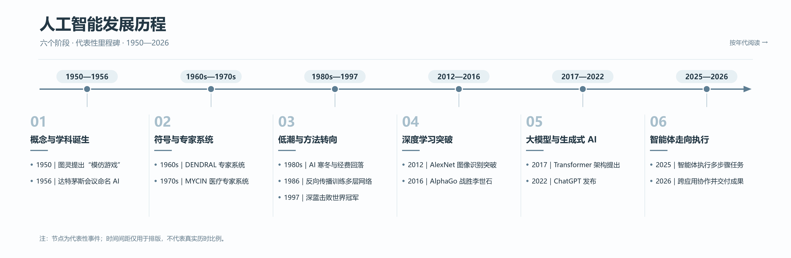

# kid-MindMap-skill

将一个主题、零散思路或资料整理成简洁、清晰的思维导图。Skill 会先确认**视觉样式**和**导图类型**，再组织内容、绘制图片并检查排版。

## 可选样式与类型

视觉样式可选黑白无填充、柔和灰蓝、对应类型的示例图风格，也可以自定义配色和节点外观。

| 导图类型 | 适合表达 |
| --- | --- |
| 右向树状 | 从中心主题逐层展开的知识结构；默认推荐 |
| 左右平衡 | 从中心向两侧展开的分类与头脑风暴 |
| 中心放射 | 围绕主题向四周发散的想法 |
| 组织结构图 | 部门、岗位或其他隶属层级 |
| 鱼骨图 | 问题的原因或对策 |
| 时间轴 | 按时间或阶段排列的事件 |

视觉样式和导图类型可以组合使用。新图只询问尚未确定的选项；修改同一张图时沿用已经确认的选择。

## 使用示例

在已加载此 Skill 的环境中输入：

> 使用 `$kid-MindMap-skill`，以“人工智能发展历程”为主题制作思维导图。

选择“柔和灰蓝＋时间轴”后，Skill 会按时间整理代表事件，制作并检查 PNG 图片；条件允许时也会保留可编辑的 SVG。

## 时间轴样式示例

下面的图片展示了本 Skill 已确认的柔和灰蓝时间轴版式。图中的历史内容只是示例，制作新图时会替换为用户提供的主题。



## 文件结构

```text
.
├─ README.md                        仓库介绍与使用示例
├─ SKILL.md                         核心工作流程与默认样式
├─ agents/openai.yaml               显示名称与默认提示词
└─ references/
   ├─ diagram-types.md              各导图类型的布局规则
   └─ images/timeline-grayblue-approved.png
```

`SKILL.md` 是技能入口；其他文件提供界面信息和按需读取的参考样式。[OpenAI 官方 Skill 文档](https://learn.chatgpt.com/docs/build-skills)说明了 Skill 的加载位置与调用方式。

> **兼容性提示：**当前保留了原定名称 `kid-MindMap-skill`。部分 Skill 校验器要求 `name` 只使用小写字母、数字和连字符；在这些环境中安装前，需将 `SKILL.md` 中的名称及 `agents/openai.yaml` 里的调用名统一改为 `kid-mindmap-skill`。
